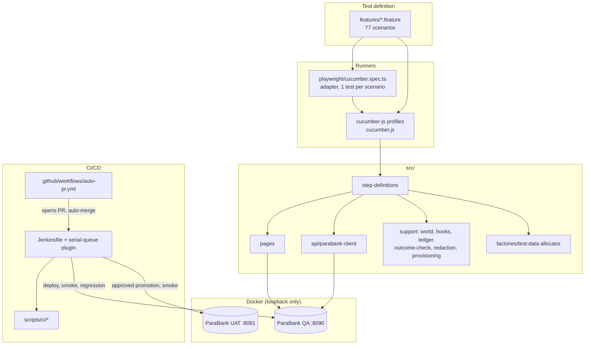
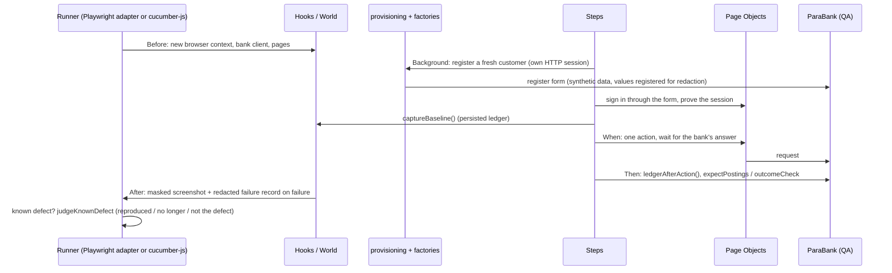
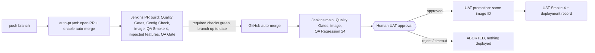

# Codebase Map

> Auto-generated by Cartographer. Last mapped: 2026-10-25T20:37:42Z. Navigation aid only: the
> rules live in [AGENTS.md](../AGENTS.md) and the linked policy documents, which win over this map.

## System Overview

Risk-based BDD suite for Parasoft ParaBank. Gherkin is the only test definition; Cucumber executes
it; Playwright drives Chromium and ParaBank's own JSON endpoints (`services_proxy`) for
state verification. One worker, no retries (PB-20). A source-built ParaBank image is deployed to
QA (`localhost:8090`), validated, and promoted by image ID to UAT (`localhost:8091`) after a human
approval in Jenkins.



## Directory Structure

```text
features/<domain>/        Gherkin: accounts, authentication, authorization, loans, payments,
                          profile, public, registration, transactions, transfers
src/
  step-definitions/       one file per domain + shared (customer, feedback, ledger)
  pages/                  Page Objects; createPages(page) in index.ts
  api/                    ParaBankClient (typed + raw-response calls), types
  support/                World, hooks, ledger, outcome checks, redaction, provisioning, config
  factories/              test-data.ts allocator, customer and payee factories
  utils/money.ts          integer-cent helpers
playwright/               adapter only: cucumber.spec.ts, runtime, known-defect proofs, reporter
scripts/                  environment lifecycle, image build, target check, log redaction, audits
scripts/ci/               CI gates (bdd structure, coverage, impacted, app image, evidence scan,
                          config check, pipeline lock, build overlap) + tests/
docker/parabank/          multi-stage source build of ParaBank (pinned commit in source.env)
docker/ci-agent/          Jenkins agent image (Playwright + Docker CLI)
jenkins/                  parabank-serial-queue-plugin (QueueTaskDispatcher)
.github/workflows/        auto-pr.yml (PR + auto-merge + sweep), playwright.yml (manual only)
docs/                     policy and coverage documents (see "Documentation")
```

## Module Guide

### Features

**Purpose**: business behavior, tags and examples. Scenario counts from a dry run (Outline rows
count individually):

| Feature                                         | Gating | Known defect |
| ----------------------------------------------- | -----: | -----------: |
| `accounts/accounts.feature`                     |      5 |            0 |
| `authentication/sign-in.feature`                |      5 |            1 |
| `authentication/login-recovery.feature`         |      3 |            1 |
| `authorization/customer-data-isolation.feature` |      0 |            7 |
| `loans/request-loan.feature`                    |      5 |            4 |
| `payments/bill-pay.feature`                     |      6 |            3 |
| `profile/update-contact-info.feature`           |      4 |            1 |
| `public/home.feature`                           |      4 |            0 |
| `registration/registration.feature`             |      5 |            3 |
| `transactions/find-transactions.feature`        |     11 |            0 |
| `transfers/transfer-funds.feature`              |      4 |            5 |
| **Total**                                       | **52** |       **25** |

Tags: one area tag (`@accounts @authentication @authorization @loan @payments @profile @public
@registration @transactions @transfer`), exactly one priority (`@p0 @p1 @p2`), suite tags
`@smoke` (4) ⊂ `@regression` (24), `@sanity` (10, manual only), Full = all 52 gating scenarios.
Known defects carry `@known-defect` + one `@PB-xx` and no suite tag. Checked by `npm run ci:bdd`.

### Runners and the Playwright adapter

**Entry points**: `npx playwright test` (canonical) and `npx cucumber-js --profile <suite>`.

| File                                 | Purpose                                                                                                                        |
| ------------------------------------ | ------------------------------------------------------------------------------------------------------------------------------ |
| `cucumber.js`                        | Profiles `default`/`full` (`not @known-defect`), `smoke`, `sanity`, `regression`, `known-defects`; parallel 1, retry 0, strict |
| `playwright.config.base.ts`          | Shared factory: workers 1, retries 0, chromium, trace only with `PW_TRACE_ON_FAILURE=true`, reporters                          |
| `playwright.config.ts`               | Default run, excludes `@known-defect`                                                                                          |
| `playwright.known-defects.config.ts` | Only `@known-defect`                                                                                                           |
| `playwright/global-setup.ts`         | Refuses `workers != 1`; runs `scripts/check-target.ts` ("TARGET UNAVAILABLE", no retry)                                        |
| `playwright/plan-scenarios.ts`       | Child process printing the scenario plan (Cucumber dry run) as JSON                                                            |
| `playwright/cucumber.spec.ts`        | The single spec: one `test` per scenario, lends the browser, runs one pickle, judges known defects                             |
| `playwright/cucumber-runtime.ts`     | `planScenarios()` / `runScenario()` over `@cucumber/cucumber/api`; support library loaded once per worker                      |
| `playwright/known-defect-proofs.ts`  | `KNOWN_DEFECT_PROOFS` (PB-xx → outcome check ids) and `judgeKnownDefect()`                                                     |
| `playwright/redacting-reporter.ts`   | First reporter; masks typed values in `Fill`/`Type` step titles and redacts other titles                                       |

### src/step-definitions

**Purpose**: thin coordination and business assertions. No selectors, no `Math.random`
(lint-enforced). Shared: `customer.steps.ts` (provisioning, sign-in proof, session ended, two
eligible accounts), `authentication.steps.ts`, `feedback.steps.ts` (`I should be told {string}` →
check `message-shown`), `ledger.steps.ts` (balance deltas, "no money should have moved").
Domain files: `accounts`, `transfer`, `bill-pay`, `loan`, `transactions`, `profile`, `public`,
`registration`, `authorization`.

### src/pages

**Purpose**: locators, navigation, interactions and waiting for the bank's answer; no `expect`
(lint-enforced). `createPages(page)` builds `world.pages`: `feedback`, `home`, `menu`,
`registration`, `customerLookup`, `customerCare`, `overview`, `accountActivity`, `openAccount`,
`transfer`, `billPay`, `findTransactions`, `updateProfile`, `requestLoan`. Inputs are located by
`id`/`name` (ParaBank has no labels); actions use `Promise.all([waitForResponse, click])`, and
transfer/loan also wait for `heading.or(errorHeading)`.

### src/support

| File                                           | Purpose                                                                                                                                               |
| ---------------------------------------------- | ----------------------------------------------------------------------------------------------------------------------------------------------------- |
| `world.ts`                                     | `ParaBankWorld`: context, pages, bank client, customer session, baseline ledger, scenario facts, `outcomeSettled`, `sensitiveValues()`                |
| `hooks.ts`                                     | Browser (lent or own), context per scenario, timeline, masked failure screenshot + failure record, audit                                              |
| `evidence.ts`                                  | Wraps every step/hook and redacts thrown errors (type preserved)                                                                                      |
| `redaction.ts`                                 | `redact`, `redactError`, `protectValues` registry, `SECRET_SHAPES` (reused by `evidence-scan`)                                                        |
| `outcome-check.ts`                             | `outcomeCheck(id, …)` wraps only assertion failures as `OutcomeCheckFailure` (10 check ids)                                                           |
| `ledger.ts`, `ledger-assertions.ts`            | Persisted state from the API; `expectPostings` (exact new entries, opened accounts, no uninvolved change)                                             |
| `provisioning.ts`                              | Registers the scenario's customer in a discarded HTTP session; browser stays signed out                                                               |
| `parameter-types.ts`                           | `{money}` (cents), `{accountRole}`, `{accountType}`, `{entryPoint}`, `{billPayField}`, `{searchCriterion}`, `{foreignResource}`, `{foreignOperation}` |
| `config.ts`, `environments.ts`                 | Target resolution (`TARGET_ENV`, `PARABANK_BASE_URL`), timeouts, QA/UAT ports and Compose projects                                                    |
| `assertions.ts`, `require-value.ts`            | `expect` with 10 s timeout; `requireValue` for facts an earlier step must have recorded                                                               |
| `browser-host.ts`                              | Lets the Playwright adapter lend its browser to the Cucumber hooks                                                                                    |
| `failure-evidence.ts`                          | Redacted failure record and timeline (the CI replacement for traces)                                                                                  |
| `network-diagnostics.ts`, `test-data-audit.ts` | Opt-in `NET_DIAG` / `TEST_DATA_AUDIT` (HMAC fingerprints) diagnostics                                                                                 |
| `bank-rules.ts`                                | Observed seed rule: opening deposit 100.00                                                                                                            |

### src/api, src/factories, src/utils

- `api/parabank-client.ts`: typed calls (`registerCustomer`, `getAccounts`, `getTransactions`,
  `getCustomer`, `openAccount`, `transfer`, …) and raw-response calls for authorization checks;
  errors carry action + status only, never bodies. `edgeRejectionHint` labels 403/429.
- `factories/test-data.ts`: the single allocator (run token + serial; SSN from a per-environment
  cursor in `.test-data/`; random password). `customer.factory.ts`, `payee.factory.ts` build on it.
- `utils/money.ts`: `parseAmount`, `centsFromApi`, `toCents`, `toAmountInput`, `formatUsd`.

### scripts/ (environment and tooling)

| File                                 | npm script                                    | Purpose                                                                                        |
| ------------------------------------ | --------------------------------------------- | ---------------------------------------------------------------------------------------------- |
| `environment.ts`                     | `env`, `qa:*`, `uat:*`, `env:identity`        | deploy/start/stop/status/health/identity/teardown; 3-layer health incl. "Database initialized" |
| `build-parabank-image.ts`            | `app:build`                                   | Builds the pinned source image, redacted output, provenance in `build/parabank-image.json`     |
| `check-target.ts`                    | `check:target`                                | Readiness probe of home and registration pages                                                 |
| `log-capture.ts`, `log-redaction.ts` | —                                             | Log window selection and line-level redaction                                                  |
| `audit-test-data.ts`                 | `audit:test-data`                             | Static audit: every repeated scenario input must be registered with a reason                   |
| `ci/verify-bdd-structure.ts`         | `ci:bdd`                                      | Tag rules, Smoke ⊂ Regression, proofs registered, totals 77 / 25                               |
| `ci/verify-suite-coverage.ts`        | `ci:coverage`                                 | Suite inventory = approved count; executed = inventory, all passed                             |
| `ci/impacted-tests.ts`               | `ci:impacted`                                 | Changed files → scenarios (fail-safe: unknown → Regression)                                    |
| `ci/app-image.ts`                    | `ci:app-image`                                | Inputs digest and REUSE / DEPLOY / BUILD decision                                              |
| `ci/config-check.ts`                 | `ci:config-check`                             | Compose rendering, source pin, `.env.example` safe defaults                                    |
| `ci/evidence-scan.ts`                | `ci:evidence-scan`                            | Fails closed on unmasked secrets/traces in archived evidence (incl. zips)                      |
| `ci/pipeline-lock.sh`                | `ci:lock`                                     | Docker-network lock (fallback serialization)                                                   |
| `ci/build-overlap.ts`                | —                                             | Forensics: Jenkins builds RUNNING at the same time                                             |
| `ci/tests/*.test.ts`                 | `test:ci`                                     | node:test self-tests (pipeline model, redaction, evidence scan, traceability, …)               |
| `ci/tests/*.sh`                      | `test:lock`, `test:queue`, `test:matrix-auth` | Docker / throwaway-Jenkins drills (on demand)                                                  |

## Data Flow

### One scenario run



A known-defect scenario counts as reproduced only when every earlier step passed and the first
failure is a `Then` failing through an `OutcomeCheckFailure` whose id is registered for its PB-xx.

### CI/CD



All Jenkins builds are serialized by the serial-queue plugin (one RUNNING build), with the Docker
network lock as fallback. The evidence scan runs before anything is archived.

## Conventions

- Layer rules in AGENTS.md "Where code goes", enforced by `eslint.config.mjs` (no selectors or
  `Math.random` in steps, no `expect` in pages, no `waitForTimeout`/`pause`/`networkidle`/
  `force: true`/XPath anywhere, no `test()` import in `src`).
- Money is integer cents; expected values come from the baseline + known inputs, never from the
  bank's answer to the action under test.
- Every scenario owns its data from the allocator; repeated inputs are registered.
- Scripts: TypeScript via ts-node with a top-level try/catch → exit 1; shell scripts POSIX `sh`
  with `set -eu` and `MSYS_NO_PATHCONV=1`.

## Gotchas

- Only the Playwright adapter judges known defects; native `cucumber-js --profile known-defects`
  simply shows all 25 red.
- The health check reports healthy up to ~30 s before ParaBank's DB is usable; use
  `npm run qa:health` (waits for "Database initialized"), not the container state.
- `deploy` recreates the container and resets data to seed; `stop`/`start` keeps it.
- Dry runs write to relative `reports/.xxx-*` paths: a Windows drive letter in a Cucumber format
  option breaks parsing.
- Area tags are `loan`/`transfer` while the directories are `loans/`/`transfers/`.
- Container names `parabank-qa-parabank-1` / `parabank-uat-parabank-1` are hardcoded in the
  Jenkinsfile and `app-image.ts`.
- `createAccount`'s response shows a zero balance; tests read persisted state instead.
- Changing `scripts/**` or the Jenkinsfile selects the full Regression on main.

## Documentation

| Topic                                 | Authoritative document                                       |
| ------------------------------------- | ------------------------------------------------------------ |
| Agent rules                           | [AGENTS.md](../AGENTS.md)                                    |
| Architecture, commands                | [README.md](../README.md)                                    |
| Suite sizes and selection criteria    | [test-suites.md](test-suites.md)                             |
| Known defects PB-01..PB-20            | [defects.md](defects.md)                                     |
| Failure triage                        | [failure-triage.md](failure-triage.md)                       |
| Test data                             | [test-data.md](test-data.md)                                 |
| CI/CD, merge policy, UAT approval     | [ci-cd.md](ci-cd.md)                                         |
| Access, backups, hardening            | [security-hardening.md](security-hardening.md)               |
| Requirements checklist                | [requirements-traceability.md](requirements-traceability.md) |
| Rules, oracles, artifact sensitivity  | [functional-coverage.md](functional-coverage.md)             |
| Per-scenario inventory                | [scenario-inventory.md](scenario-inventory.md)               |
| Review standard, prompts, MCP verdict | [ai/](ai/)                                                   |

## Navigation Guide

- **Add a scenario**: `features/<domain>/*.feature` → reuse steps (`npm run test:dry-run`) → new
  steps in `src/step-definitions/<domain>.steps.ts` → locators in `src/pages/` → data in
  `src/factories/` → `/new-scenario` skill and `docs/ai/test-quality-gates.md`.
- **Add a known defect**: scenario with `@known-defect @PB-xx` stating correct behavior → entry in
  `docs/defects.md` → proof in `playwright/known-defect-proofs.ts` → `outcomeCheck` id in
  `src/support/outcome-check.ts`.
- **Change a locator**: the Page Object in `src/pages/` only.
- **Change verification of persisted state**: `src/support/ledger*.ts`, `src/api/parabank-client.ts`.
- **Change redaction**: `src/support/redaction.ts`, `evidence.ts`, `playwright/redacting-reporter.ts`,
  `scripts/log-redaction.ts`, then `npm run ci:evidence-scan -- reports`.
- **Investigate a failure**: `docs/failure-triage.md`, `reports/**/failures/*.json`, the
  `failure-triager` subagent.
- **Environments**: `scripts/environment.ts` (`npm run qa:health|status|start`).
- **CI/CD** (human approval required for changes): `Jenkinsfile`, `scripts/ci/`,
  `.github/workflows/`, `jenkins/`, `docker/`.
